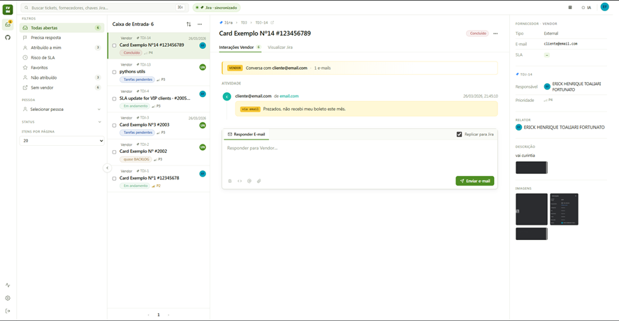
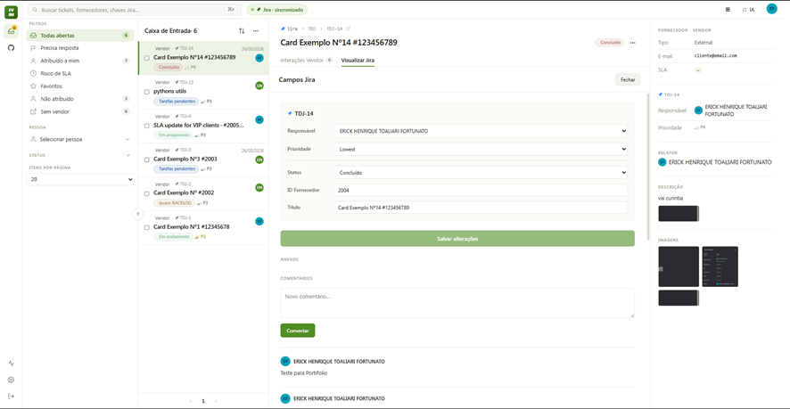
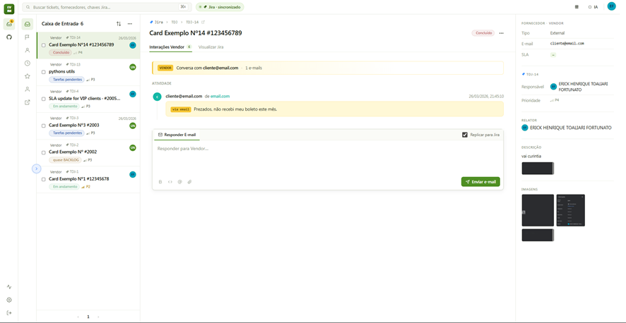
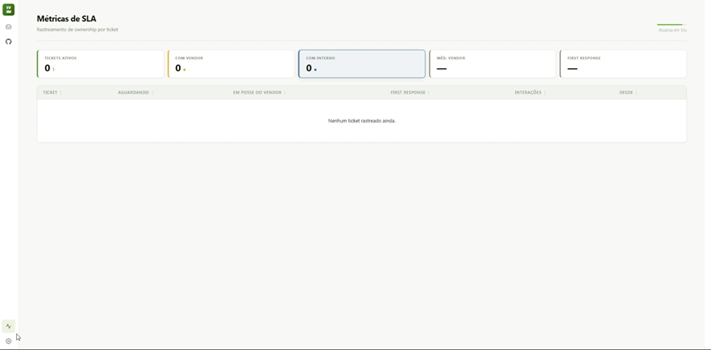
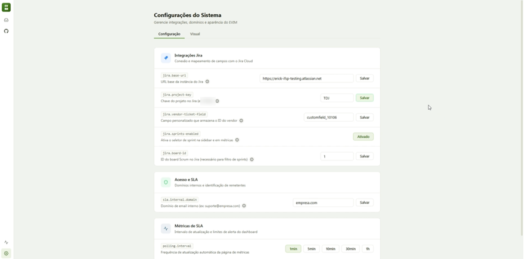
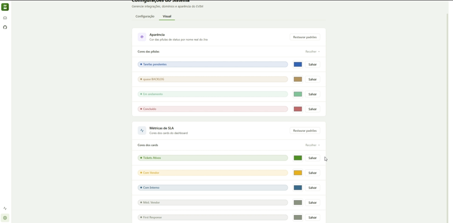

# EVIM — Enhanced Vendor Interaction Middleware

> **Prova de conceito descontinuada.** Desenvolvida para o fluxo de suporte B2B
> com fornecedores de um cliente. Este repositório é um **snapshot antigo**,
> publicado de forma anonimizada como referência de portfólio. O produto seguiu
> evoluindo internamente, com outra arquitetura (por exemplo, integração direta
> com Zendesk no lugar do Microsoft Graph). Nomes de empresas, dados reais e
> infraestrutura foram removidos. Todos os direitos reservados.

Plataforma para centralizar o suporte a fornecedores: ingere e-mails de uma
caixa compartilhada (Microsoft Graph), reconstrói as threads dos portais de
atendimento, vincula cada conversa a um ticket Jira e acompanha o SLA de quem
está com a bola (time interno ou fornecedor).

## Screenshots

<table>
  <tr>
    <td></td>
    <td></td>
  </tr>
</table>

<details>
<summary>Sidebar recolhida</summary>
<br>

</details>

<table>
  <tr>
    <td></td>
    <td></td>
  </tr>
  <tr>
    <td colspan="2"></td>
  </tr>
</table>

## Destaques

- **Arquitetura hexagonal** no backend (ports and adapters), com Graph e Jira atrás de portas.
- **Parser de threads de portal**: transforma um único HTML com todo o histórico
  em mensagens separadas (autor, empresa, data, corpo), removendo preheader oculto,
  boilerplate, assinaturas e links encapsulados (Safe Links, Proofpoint).
- **Integração Jira** com OAuth2 por usuário (Atlassian) e fallback por service account.
- **Métricas de SLA** por ownership (interno vs. fornecedor) e atualização em tempo real.
- **Frontend React** com autenticação OIDC, inbox paginada, painel Jira e tela de administração.

## Estrutura do repositório

```
.
├── backend/    # Spring Boot 4 · Java 21 · PostgreSQL
├── frontend/   # React 19 · Vite 8 · OIDC
└── docs/       # screenshots
```

## Build e testes

Este snapshot **não roda de forma independente**: todas as rotas exigem um token
de um provedor OIDC (Keycloak) e a inbox é montada a partir de issues de um Jira
Cloud. O Microsoft Graph pode ser desligado (`graph.mock.enabled=true`, o padrão
aqui), mas aí nenhum e-mail é ingerido. O código compila e os testes rodam sem
nenhum serviço externo:

```bash
# Backend — Java 21
cd backend
./mvnw test

# Frontend — Node 20+
cd frontend
npm ci
npm run build
```

Para subir de verdade, o backend lê a configuração de **variáveis de ambiente**
(o Spring não carrega `.env`; veja [Variáveis de Ambiente](#variáveis-de-ambiente)),
o Postgres sobe com `docker compose up -d` em `backend/`, e o frontend lê
`frontend/.env` (copie de `frontend/.env.example`).

---

# Frontend

## Stack

| Camada | Tecnologia |
|--------|-----------|
| Runtime | React 19 |
| Autenticação | Keycloak via `oidc-client-ts` + `react-oidc-context` |
| Container | Docker Compose (node:20) |

## Requisitos

- Node 20+
- Variáveis de ambiente (`.env`):
  - `VITE_API_BASE_URL` — URL base da API backend
  - `VITE_OIDC_AUTHORITY` — URL do realm Keycloak
  - `VITE_OIDC_CLIENT_ID` — Client ID OIDC
  - `VITE_OIDC_REDIRECT_URI` — URI de redirect pós-login

```bash
docker compose up   # sobe o dev server em container node:20
```

Porta exposta: `5173`. Proxy configurado em `vite.config.js`:
- `/deploy-api` → `http://host.docker.internal:8081`

## Estrutura

```
src/
├── App.jsx                  # Rotas, providers, lógica global
├── main.jsx                 # Entry point (OIDC provider wrapping)
├── auth/
│   └── oidcConfig.js        # Configuração Keycloak/OIDC
├── assets/icons/            # Ícones SVG como componentes React
├── components/
│   ├── Shell.jsx            # Layout principal (Rail, TopBar, Sidebar)
│   ├── Queue.jsx            # Lista de tickets (inbox)
│   ├── Detail.jsx           # Detalhe do ticket + DetailAside
│   ├── DeployPage.jsx       # Interface de deploy
│   ├── AdminPanel.jsx       # Painel de configuração admin
│   ├── MetricsPage.jsx      # Dashboard de métricas SLA
│   ├── JiraPanel.jsx        # Painel de integração Jira
│   ├── LinkAtlassianPage.jsx # Tela de vinculação OAuth Atlassian (condicional)
│   ├── SecondaryLayout.jsx  # Layout wrapper secundário
│   ├── Skeleton.jsx         # Placeholders de carregamento
│   ├── Tooltip.jsx          # Componente tooltip
│   ├── Tour.jsx             # Tour guiado de onboarding
│   ├── Rail.jsx             # Navegação lateral vertical
│   ├── Icons.jsx            # Wrapper de ícones
│   └── data.jsx             # Dados estáticos/mock
├── constants/
│   └── colors.js            # Paleta de cores por status
├── context/
│   └── StatusColorsContext.js # Contexto de cores de status
├── hooks/
│   ├── useConversations.js  # Fetch de cards Jira + paginação
│   ├── useFeedback.js       # Estado de feedback UI
│   ├── useJiraCard.js       # Fetch de card + transições
│   ├── useOutsideClick.js   # Detecção de clique fora do elemento
│   └── useToast.jsx         # Sistema de notificações toast
├── services/
│   ├── api.js               # Camada HTTP (fetch + auth bearer)
│   └── metricsSettings.js   # Configurações de métricas
├── styles/                  # CSS global (variáveis, utilitários, badges)
└── utils/
    └── string.js            # Utilitários de string
```

## Rotas

| Path | Componente | Descrição |
|------|-----------|-----------|
| `/` | App (Queue) | Inbox de tickets — exibe `LinkAtlassianPage` se Atlassian não vinculado |
| `/deploy` | DeployPage | Interface de deploy |
| `/admin` | AdminPanel | Configurações admin |
| `/metrics` | MetricsPage | Dashboard SLA |

## API Endpoints Consumidos

| Grupo | Endpoints |
|-------|-----------|
| Cards (Jira) | `GET /card/search`, `GET /card/:key`, `PATCH /card/:key`, `GET /card/:key/transitions`, `POST /card/:key/comment`, `GET /card/sprints`, `GET /card/statuses`, `GET /card/priorities`, `GET /card/users/assignable/default`, `GET /card/counts`, `GET /card/attachment/:id/content`, `PUT /card/:key/star`, `DELETE /card/:key/star`, `GET /card/starred/keys` |
| Email | `GET /email/by-ticket/:id`, `GET /email/by-ticket/:id/thread-messages`, `POST /email/send` (multipart) |
| Conversations | `GET /conversations?ticketId=...`, `GET /conversations/ticket/:id/last-interaction` |
| Admin | `GET /admin/config/public`, `GET /admin/config`, `PUT /admin/config/:key` |
| Auth | `GET /auth/atlassian/status`, `GET /auth/atlassian/initiate` |
| Metrics | `GET /metrics?sprintId=...` |

## Autenticação

OIDC/Keycloak. O token é injetado em todas as requisições via header `Authorization: Bearer <token>`. Header especial `X-Atlassian-Reauth: required` dispara re-autenticação Atlassian.

---

# Backend

## Arquitetura

O projeto segue **Arquitetura Hexagonal** (Ports and Adapters):

```
src/main/java/com/example/EVIM/
├── domain/
│   ├── model/          ← Entidades de domínio (POJOs com Lombok)
│   ├── port/out/       ← Interfaces de saída (contratos)
│   ├── service/        ← Serviços de domínio (HtmlSanitizer, TextNormalizer,
│   │                     PortalEmailThreadParser facade, SenderClassification)
│   └── parsing/        ← Subsistema de parsing de threads (componentes coesos)
│       ├── HeaderDetector        ← detecção de author/date headers
│       ├── DateRecognizer         ← parsing de datas PT/EN/ES/ISO
│       ├── BoilerplateFilter      ← regras de boilerplate (com BoilerplateRule)
│       ├── HtmlToPlainTextConverter ← HTML→texto (pre-strip preheaders ocultos,
│       │                            sanitizer injetado, unwrap Proofpoint v3)
│       ├── UrlUnwrapper           ← desfaz wrappers Proofpoint/SafeLinks
│       ├── SignatureStripper      ← remove blocos de assinatura trailing
│       │                            (Atte. + nome + telefone + email)
│       └── ThreadSplitter         ← máquina de estado de split de mensagens
├── application/        ← Casos de uso, orquestração, DTOs
│   ├── auth/           ← Contexto de credenciais Atlassian
│   ├── config/         ← Configuração de aplicação
│   ├── dto/            ← Data Transfer Objects (Java Records)
│   └── metrics/        ← Observabilidade do parser (zero-dep)
│       ├── ParserMetrics          ← contadores AtomicLong (success/fallback/failed/boilerplateByRule)
│       └── ParseDiagnostic        ← record de diagnóstico emitido por parse
├── adapter/
│   ├── in/
│   │   ├── web/        ← Controllers REST
│   │   ├── scheduler/  ← Jobs agendados (@Scheduled)
│   │   └── filter/     ← Filtros HTTP (AtlassianCredentialsFilter)
│   └── out/
│       ├── graph/      ← Microsoft Graph API (fetch/send e-mails)
│       ├── jira/       ← Jira Cloud REST API (client, mapper, util)
│       └── persistence/← JPA (PostgreSQL)
└── config/             ← Security, Jackson, CORS
```

**Fluxo de dependência:** `adapter/in → application → domain ← adapter/out`

Os adapters de entrada (controllers, schedulers) chamam os serviços de aplicação, que operam sobre o domínio através de ports. Os adapters de saída implementam os ports definidos no domínio.

---

## Tecnologias

| Camada     | Tecnologia |
|------------|-----------|
| Runtime    | Java 21 (Amazon Corretto), Spring Boot |
| APIs       | Spring Web (REST)|
| Segurança  | Spring Security + OAuth2 Resource Server (JWT via Keycloak) |
| E-mail     | Microsoft Graph SDK v6.6.0 + `java.net.http.HttpClient` (fetch paginado) |
| Credential | Azure Identity (ClientSecretCredential) com OkHttp |
| Jira       | REST API v3 (OAuth2 por usuário + Basic Auth fallback) |
| Banco      | PostgreSQL|

---

## Configuração

### Pré-requisitos

- Java 21 (Amazon Corretto 21 recomendado)
- Docker (para PostgreSQL)
- Keycloak (OIDC provider)
- Registro de aplicação no Azure AD/Graph API (Somente Administrador)
- Registro de aplicação no Atlassian Developer Console (Consultar Scopes)

### application.properties

```properties
# Banco de dados
spring.datasource.url=jdbc:postgresql://localhost:5433/Manager_DB
spring.datasource.username=${DB_USERNAME:evim}
spring.datasource.password=${DB_PASSWORD:evim}
spring.jpa.hibernate.ddl-auto=update

# OIDC (Keycloak)
spring.security.oauth2.resourceserver.jwt.issuer-uri=${OIDC_ISSUER_URI}

# Atlassian OAuth2
atlassian.client-id=${ATLASSIAN_CLIENT_ID}
atlassian.client-secret=${ATLASSIAN_CLIENT_SECRET}
atlassian.redirect-uri=${ATLASSIAN_REDIRECT_URI}
atlassian.frontend-url=${ATLASSIAN_FRONTEND_URL}

# Jira (service account — fallback quando não há OAuth do usuário)
jira.base-url=${jira_base_url}
jira.username=${jira_username}
jira.api-token=${jira_api_token}
jira.project-key=${jira_project_key}

# Microsoft Graph API
graph.tenant-id=${GRAPH_TENANT_ID}
graph.client-id=${GRAPH_CLIENT_ID}
graph.client-secret=${GRAPH_CLIENT_SECRET}
graph.mailbox-user-id=${GRAPH_MAILBOX_USER_ID}
graph.folder-id=${GRAPH_FOLDER_ID}
graph.mock.enabled=true
graph.poll.fixed-delay-ms=60000
```

---

## Banco de Dados

### Email

| Campo | Tipo | Descrição |
|-------|------|-----------|
| `id` | Long | PK auto-gerado |
| `sender` | String | Endereço do remetente |
| `receiver` | String | Endereço do primeiro destinatário |
| `subject` | String | Assunto |
| `body` | String (TEXT) | Corpo HTML do e-mail |
| `received` | LocalDateTime | Data/hora de recebimento (UTC) |
| `status` | Status (enum) | Open, UnderReview, PendingCustomer, CustomerValidation, Closed |
| `messageId` | String (UNIQUE) | ID da mensagem no Graph API |
| `conversationId` | Long (FK) | Conversa associada |
| `attachments` | List\<Attachment\> | Anexos do e-mail |

### Conversation

| Campo | Tipo | Descrição |
|-------|------|-----------|
| `id` | Long | PK auto-gerado |
| `ticketId` | Integer | Número do ticket do fornecedor (extraído do subject/body) |
| `subject` | String | Assunto normalizado |
| `status` | Status | Status da conversa |
| `priority` | Priority | High, Medium, Low |
| `lastUpdate` | LocalDateTime | Última atualização (último e-mail recebido) |
| `pendingResponse` | Boolean | `true` = aguardando resposta do fornecedor |
| `externalBoardId` | String | Chave do issue Jira (ex: `EVIM-123`) |

### ThreadMessage

| Campo | Tipo | Descrição |
|-------|------|-----------|
| `id` | Long | PK |
| `emailId` | Long (FK) | E-mail de origem (portal) |
| `conversationId` | Long (FK) | Conversa associada |
| `author` | String | Nome do autor da mensagem |
| `company` | String | Empresa do autor |
| `sentAt` | LocalDateTime | Data/hora do envio |
| `body` | String | Corpo da mensagem individual |
| `ordinal` | Integer | Ordem na thread (0 = mais recente) |

### Attachment

| Campo | Tipo | Descrição |
|-------|------|-----------|
| `id` | Long | PK |
| `fileName` | String | Nome do arquivo |
| `contentType` | String | MIME type |
| `contentBytes` | byte[] | Conteúdo binário |
| `emailId` | Long (FK) | E-mail ao qual pertence |

### SlaOwnershipLog

| Campo | Tipo | Descrição |
|-------|------|-----------|
| `id` | Long | PK |
| `jiraKey` | String | Chave do issue Jira |
| `ownerType` | OwnerType | VENDOR ou INTERNAL |
| `startAt` | LocalDateTime | Início do período de ownership |
| `endAt` | LocalDateTime | Fim (null = período ativo) |

---

## Fluxos da Aplicação

### 1. Ingestão de E-mails

A ingestão é o fluxo principal do sistema. Busca e-mails não lidos da caixa compartilhada, na pasta especificada (graph.folder-id}
) e os processa.

**Trigger:** `EmailPollingScheduler` executa a cada 60 segundos (`fixedDelay`), ou manualmente via `POST /email/ingest`.

**Proteção contra concorrência:** `AtomicBoolean` no `EmailIngestionService` impede que o scheduler e um trigger manual executem simultaneamente.

```
EmailPollingScheduler (@Scheduled, 60s)
  │
  ▼
EmailIngestionService.ingestNewEmails()
  │
  ├─ Adquire lock (AtomicBoolean.compareAndSet)
  │
  ├─ EmailFetchPort.fetchNewEmails(pageConsumer)
  │   │
  │   │  ┌─────────────────────────────────────────────┐
  │   └─▶│ GraphMailFetchAdapter                       │
  │      │                                             │
  │      │ 1. Obtém access token via                   │
  │      │    ClientSecretCredential                   │
  │      │                                             │
  │      │ 2. HTTP GET direto (java.net.http):         │
  │      │    /users/{userId}/mailFolders/{folderId}/  │
  │      │    messages?$filter=isRead eq false          │
  │      │    &$top=50                                 │
  │      │                                             │
  │      │ 3. Para cada página de 50 e-mails:          │
  │      │    - Mapeia JSON → Email via                │
  │      │      GraphEmailMapper.fromJsonNode()        │
  │      │    - Se hasAttachments: busca via SDK        │
  │      │    - Entrega página ao consumer             │
  │      │                                             │
  │      │ 4. Segue @odata.nextLink (com validação     │
  │      │    de domínio graph.microsoft.com)           │
  │      │                                             │
  │      │ 5. Retorna total de e-mails fetchados       │
  │      └─────────────────────────────────────────────┘
  │
  ├─ Para cada e-mail na página:
  │   │
  │   ├─ EmailProcessingService.processSingleEmail(email)
  │   │   (cada e-mail em sua própria @Transactional)
  │   │
  │   ├─ Se processou com sucesso:
  │   │   └─ emailFetchPort.markAsRead(messageId)
  │   │      (PATCH via Graph SDK — fora da transação)
  │   │
  │   ├─ Se duplicado: incrementa contador de skipped
  │   │
  │   └─ Se erro: incrementa contador, loga, continua
  │
  ├─ Loga progresso a cada página
  │
  └─ Libera lock (finally)
```

**Decisão arquitetural:** O `markAsRead` é executado **fora** da transação JPA. Se o e-mail for salvo no banco mas o `markAsRead` falhar, o e-mail será re-fetchado no próximo polling — mas a deduplicação por `messageId` (UNIQUE) impedirá reprocessamento. Isso garante que nenhum e-mail seja perdido.

---

### 2. Processamento Individual de E-mail

`EmailProcessingService.processSingleEmail()` — anotado com `@Transactional` (cada e-mail = 1 transação).

```
processSingleEmail(email)
  │
  ├─ 1. DEDUPLICAÇÃO
  │   └─ findByMessageId(email.messageId)
  │      Se já existe → return false (skip)
  │
  ├─ 2. RESOLUÇÃO DE CONVERSA
  │   │
  │   ├─ Normaliza subject:
  │   │   Remove prefixos Re: / Fwd: / Fw: / AW: / ENC:
  │   │   recursivamente (ex: "Re: Fwd: Re: Problema" → "Problema")
  │   │
  │   ├─ Busca conversas existentes por subject similar:
  │   │   SELECT DISTINCT conversation_id
  │   │   FROM tb_email
  │   │   WHERE LOWER(subject) LIKE '%problema%'
  │   │   ORDER BY conversation_id ASC
  │   │
  │   ├─ Se encontrou → usa a conversa existente (menor ID)
  │   └─ Se não → cria nova conversa (status=Open, pendingResponse=true)
  │
  ├─ 3. EXTRAÇÃO DE TICKET DO FORNECEDOR
  │   │
  │   │  Tenta extrair número de 8 dígitos do ticket:
  │   │
  │   ├─ Subject: regex \b(\d{8})\b
  │   │   Ex: "Problema ticket 12345678" → 12345678
  │   │
  │   ├─ Body (sem HTML): regex \((\d{8})\)
  │   │   Ex: "Referente ao chamado (12345678)" → 12345678
  │   │
  │   └─ Body: regex solicita[çc][aã]o\s+n.*(\d{8})
  │       Ex: "Solicitação nº 12345678" → 12345678
  │
  │   Se encontrou e conversa não tem ticketId:
  │   → conversation.ticketId = Integer(ticket)
  │
  ├─ 4. ATUALIZA CONVERSA
  │   ├─ lastUpdate = email.received (ou now)
  │   ├─ pendingResponse = !isInternalSender(email.sender)
  │   │   (usa SenderClassificationService — checa domínio
  │   │    contra config 'sla.internal.domain')
  │   └─ save(conversation)
  │
  ├─ 5. PERSISTE E-MAIL + ANEXOS
  │   ├─ email.conversationId = conversation.id
  │   ├─ Separa anexos do e-mail (evita cascade)
  │   ├─ save(email) → obtém email.id
  │   └─ Para cada anexo:
  │       attachment.emailId = email.id
  │       save(attachment)
  │
  ├─ 6. PARSE DE THREAD MESSAGES
  │   └─ (ver seção 3 abaixo)
  │
  └─ 7. TRACKING DE SLA
      ├─ Se remetente é fornecedor (externo):
      │   E conversa tem Jira vinculado:
      │   → slaMetricsService.onVendorEmailReceived(jiraKey)
      │     (transição VENDOR → INTERNAL)
      └─ return true
```

---

### 3. Parsing de Thread Messages

E-mails de portais de atendimento (ex.: o portal de atendimento de um fornecedor) chegam como um único HTML contendo todo o histórico da conversa. O `PortalEmailThreadParser` (facade) delega a um pipeline de componentes em `domain/parsing/`.

#### Arquitetura do Parser

```
PortalEmailThreadParser (facade, API estática)
  │
  ├─ HtmlToPlainTextConverter
  │   ├─ Recebe UnaryOperator<String> sanitizer (injeção funcional)
  │   ├─ Recebe Predicate<String> isProperName
  │   ├─ Pre-pass: removeHiddenElements() — strip <div style="display:none">,
  │   │   visibility:hidden, opacity:0, max-height:0, font-size:1px e o
  │   │   atributo HTML5 `hidden`. Necessário ANTES do sanitizer OWASP, que
  │   │   removeria os valores CSS proibidos e deixaria o elemento órfão.
  │   ├─ Decode de duplo escape (&lt;a&gt; → <a>) quando o body veio com
  │   │   HTML entity-encoded
  │   ├─ Aplica sanitizer → JSoup DOM walk → markdown links → img-alt promotion
  │   └─ Retorna plain text
  │
  ├─ UrlUnwrapper (utility)
  │   ├─ Desfaz Proofpoint v3 (`urldefense.com/v3/__<url>__;...`)
  │   ├─ Desfaz Microsoft SafeLinks (`*.safelinks.protection.outlook.com`)
  │   └─ Aplicado pelo HtmlToPlainTextConverter ao reescrever <a href>
  │
  ├─ ThreadSplitter (máquina de estado)
  │   ├─ normalizeLines() → remove zero-width, colapsa brancos
  │   ├─ Loop principal:
  │   │   ├─ Try 1: two-line header (AUTHOR_LINE + date within 5 lines)
  │   │   └─ Try 2: inline header
  │   ├─ collectBody() até próximo header
  │   ├─ cleanOrphanHeaders() (usa dateRecognizer.isExactlyDate)
  │   └─ Pós-processo: SignatureStripper.strip() em cada body emitido
  │
  ├─ HeaderDetector
  │   ├─ AUTHOR_LINE pattern (Unicode-aware)
  │   ├─ isProperName() — multi-word capitalized name
  │   ├─ tryInlineHeader() — email + nome + data na mesma linha
  │   ├─ findDateLineWithin() — busca data nas próximas N linhas
  │   └─ startsWithUpper() — trata acentos/BMP+
  │
  ├─ DateRecognizer
  │   ├─ DATE_LINE pattern combinado (PT/EN/ES/ISO/numérico)
  │   ├─ parseDate() → LocalDateTime ou null
  │   ├─ containsDate() — find()
  │   └─ isExactlyDate() — matches() (full line)
  │
  ├─ SignatureStripper
  │   ├─ Heurística bottom-up: classifica linhas como SIGNATURE (email,
  │   │   telefone, URL, ALL CAPS name, dept, slogan) / WEAK_SIGNATURE
  │   │   (title-case name) / DELIMITER (Atte., Atenciosamente, separador)
  │   │   / BLANK / CONTENT
  │   ├─ Só corta se houver pelo menos um sinal forte (email/telefone/URL/
  │   │   closing) e o body sobrevivente ainda tiver prosa real
  │   ├─ Atachments vivem no agregado Email — nunca são tocados
  │   └─ isEffectivelyEmpty(body) — true quando o body é só saudação +
  │       assinatura, usado pelo fallback do ThreadMessageBuilder para
  │       suprimir interações fantasma (auto-acks do portal)
  │
  └─ BoilerplateFilter
      ├─ BoilerplateRule record (name, pattern, minLineLength, priority)
      │   └─ implements Comparable (priority desc → minLineLength desc → pattern length desc)
      ├─ 50+ regras default (portal do fornecedor, CSAT/NPS survey, [EXTERNAL]/
      │   [EXTERNO] banners, Proofpoint, disclaimers, closings)
      ├─ Regra `vendor-portal.solicitacao-atualizada` exige dígito (nº do ticket)
      │   para não consumir prosa legítima como "Sua solicitação foi
      │   recebida em nossa fila"
      ├─ Regra `vendor-portal.csat-score-line` casa tanto dígitos puros (0..10)
      │   quanto a forma markdown-link "[N](https://surveys...)" que cada
      │   nota assume após HTML→texto
      ├─ isBoilerplate() / matchedRule()
      ├─ Consumer<String> onRuleMatched (callback para métricas)
      └─ stripFromText(text, isProperName) — strip + trailing signature trim
```

#### ParseResult

```java
public record ParseResult(List<ParsedMessage> messages, String plainText) {}
```

O `parseDetailed(html)` retorna ambos, evitando double-parse no fallback path.

#### Orquestração de persistência (ThreadMessageBuilder)

```
ThreadMessageBuilder.buildAndSave(savedEmail, conversation)
  │
  ├─ PortalEmailThreadParser.parseDetailed(email.body)
  │   → ParseResult { messages, plainText }
  │
  ├─ Se messages vazio → fallback:
  │   ├─ stripBoilerplate(plainText) + SignatureStripper.strip()
  │   ├─ Se body fica vazio → ParseDiagnostic.failed("blank-after-strip")
  │   ├─ Se body é efetivamente vazio (só saudação + assinatura) →
  │   │   ParseDiagnostic.failed("phantom-empty") — suprime auto-acks
  │   │   do portal que surfariam como "Olá Lucas," + assinatura
  │   └─ Senão salva como mensagem única usando senderDisplayName/Address
  │
  ├─ Verifica se este e-mail é o mais recente da conversa
  │
  ├─ Se é o mais recente (ou único):
  │   ├─ Remove thread messages anteriores da conversa
  │   └─ Salva novas thread messages (ordinal = 0..N)
  │
  └─ Emite ParseDiagnostic → ParserMetrics
```

#### Reparse em lote (ThreadReparseService)

```
POST /admin/reparse-threads        → reparse de TODOS os e-mails
POST /admin/reparse-threads        → reparse escopado por payload:
  body { "conversationIds":[…], "emailIds":[…] }
  │
  ├─ Resolve escopo (conversationIds expandem para emailIds via repository)
  ├─ Disparado em virtual thread (assíncrono, não bloqueia o request)
  ├─ Chunked (200 e-mails por chunk) com @Transactional por chunk
  ├─ Reparse limpa thread messages stale do e-mail antes de reescrever
  ├─ Status: GET /admin/reparse-threads/status →
  │   { running, total, processed, progress, newlyParsed,
  │     failedEmails, fallbackEmails, status, finishedAt }
  └─ Cancelável: DELETE /admin/reparse-threads
```

Exemplo (escopado por conversa):

```bash
curl -X POST http://localhost:8080/admin/reparse-threads \
  -H "Content-Type: application/json" \
  -d '{"conversationIds":[28]}'
curl http://localhost:8080/admin/reparse-threads/status
```

#### Observabilidade (ParserMetrics — zero-dep)

Contadores AtomicLong expostos em `GET /admin/parser-metrics`:
- `success` / `fallback` / `failed` / `dateUnparsed`
- `messagesEmitted` (total sub-messages parsed)
- `successByDomain` / `fallbackByDomain` (per-sender-domain breakdown)
- `boilerplateByRule` (per-rule hit counts via BoilerplateFilter callback)

Reset via `DELETE /admin/parser-metrics`.

**Por que a decisão de substituir e não acumular?** Os e-mails do portal do fornecedor contêm o histórico completo. Cada novo e-mail (interação) traz todas as mensagens anteriores + novas. Manter ambos causaria duplicação.

---

### 4. Envio de E-mails

```
POST /email/send
  Body: { ticketId, to, subject, body, replicateToJira }
  Auth: JWT (Keycloak)
  │
  ▼
EmailSendService.send(dto, jwtAuth)
  │
  ├─ 1. Extrai nome do usuário do JWT (claim "name" ou "email")
  │
  ├─ 2. Adiciona assinatura HTML:
  │     <hr><small><strong>{nome}</strong> via E-VIM</small>
  │
  ├─ 3. Envia via Graph API:
  │   │
  │   └─ GraphMailSendAdapter.sendOnBehalf()
  │       POST /users/{mailboxUserId}/sendMail
  │       {
  │         message: {
  │           from: { name: "João via ", address: mailboxUserId },
  │           to: [{ address: dto.to }],
  │           subject: dto.subject,
  │           body: { contentType: "HTML", content: bodyComAssinatura }
  │         },
  │         saveToSentItems: true
  │       }
  │
  ├─ 4. Salva registro do e-mail enviado:
  │     Email { sender=displayName, receiver=dto.to, ... }
  │     Vincula à conversa pelo ticketId
  │
  └─ 5. Se replicateToJira = true:
        ├─ Strip HTML do body → texto puro
        ├─ Monta comentário em ADF (Atlassian Document Format)
        └─ ProviderCommentPort.addComment(issueKey, adfJson)
           POST /rest/api/3/issue/{issueKey}/comment
```

---

### 5. Ciclo de Vida de Conversas

```
CRIAÇÃO (automática durante ingestão)
  │
  │  E-mail chega → normaliza subject (assubto) → não encontra conversa existente
  │  → Cria Conversation { status=Open, pendingResponse=true }
  │
  ▼
ATUALIZAÇÃO (a cada novo e-mail)
  │
  │  Cada e-mail recebido atualiza:
  │  - lastUpdate = data do e-mail
  │  - pendingResponse = true (se remetente externo)
  │                      false (se remetente interno)
  │
  ▼
VINCULAÇÃO COM JIRA
  │
  │  PATCH /conversations/{id}/link-jira
  │  Body: "EVIM-123"
  │
  │  ConversationService.updateExternalBoardId():
  │  1. conversation.externalBoardId = "EVIM-123"
  │  2. save(conversation)
  │  3. slaMetricsService.onJiraLinked(jiraKey, pendingVendor)
  │     → Inicia rastreamento de SLA
  │
  ▼
CONSULTAS
  │
  ├─ GET /conversations → lista paginada com filtros (status, ticketId)
  ├─ GET /conversations/by-provider-assignee/{accountId} → por responsável Jira
  ├─ GET /conversations/by-provider-unassigned → não atribuídas
  └─ GET /conversations/ticket/{ticketId}/last-interaction → último e-mail
```

---

### 6. Integração com Jira

A integração usa **dois mecanismos de autenticação**:

1. **OAuth2 por usuário** — token individual vinculado via `AtlassianCredentialsFilter` (thread-local). Usado quando o usuário está autenticado e tem token Atlassian válido.
2. **Basic Auth (service account)** — fallback quando não há OAuth. Configurado via `jira.username` + `jira.api-token`.

```
ProviderApiClient (HTTP client centralizado)
  │
  ├─ Se CredentialsContext tem token OAuth → usa Bearer token
  └─ Senão → usa Basic Auth (service account)
```

#### Operações/Endpoints Jira

| Operação | Endpoint Jira | Serviço |
|----------|--------------|---------|
| Buscar issue | `GET /rest/api/3/issue/{key}` | ProviderIssueService |
| Pesquisar issues (JQL) | `POST /rest/api/3/search/jql` | ProviderIssueService |
| Atualizar issue | `PUT /rest/api/3/issue/{key}` | ProviderIssueUpdateService |
| Transição de status | `POST /rest/api/3/issue/{key}/transitions` | ProviderIssueUpdateService |
| Listar transições | `GET /rest/api/3/issue/{key}/transitions` | ProviderTransitionService |
| Adicionar comentário | `POST /rest/api/3/issue/{key}/comment` | ProviderCommentService |
| Usuários atribuíveis | `GET /rest/api/3/user/assignable/search` | ProviderUserService |
| Usuário atual | `GET /rest/api/3/myself` | ProviderUserService |

#### Construção de JQL

```
Base: project = {projectKey}

Filtros opcionais:
  + AND status = "{status}"
  + AND assignee = "{accountId}"
  + AND assignee = EMPTY
  + AND {vendorTicketField} ~ "{ticketId}"
  + AND sprint = {sprintId}

ORDER BY created DESC
```

#### PATCH de Issue

`PATCH /card/{issueKey}` suporta atualização parcial:

```json
{
  "summary": "Novo título",
  "vendorTicket": "12345678",
  "priorityId": "3",
  "assigneeAccountId": "5f7...",
  "transitionId": "31"
}
```

Campos `null` são ignorados. `assigneeAccountId = ""` remove o responsável.

---

### 7. Fluxo OAuth2 Atlassian

```
┌──────────┐     ┌──────────────┐     ┌─────────────────┐
│ Frontend │     │   Backend    │     │   Atlassian     │
└────┬─────┘     └──────┬───────┘     └────────┬────────┘
     │                  │                      │
     │ GET /auth/       │                      │
     │ atlassian/       │                      │
     │ initiate         │                      │
     ├─────────────────▶│                      │
     │                  │                      │
     │  { redirectUrl } │                      │
     │◀─────────────────┤                      │
     │                  │                      │
     │ window.location  │                      │
     │ = redirectUrl    │                      │
     ├──────────────────┼─────────────────────▶│
     │                  │                      │
     │                  │   GET /callback?     │
     │                  │   code=xxx&state=yyy │
     │                  │◀─────────────────────┤
     │                  │                      │
     │                  │  POST /oauth/token   │
     │                  │  (exchange code)     │
     │                  ├─────────────────────▶│
     │                  │                      │
     │                  │  { access_token,     │
     │                  │    refresh_token }   │
     │                  │◀─────────────────────┤
     │                  │                      │
     │                  │  GET /accessible-    │
     │                  │  resources           │
     │                  ├─────────────────────▶│
     │                  │                      │
     │                  │  [{ id: cloudId }]   │
     │                  │◀─────────────────────┤
     │                  │                      │
     │                  │  Salva token no DB:  │
     │                  │  keycloakSub →       │
     │                  │  { token, cloudId }  │
     │                  │                      │
     │ 302 Redirect     │                      │
     │ → frontend?      │                      │
     │   atlassian=     │                      │
     │   linked         │                      │
     │◀─────────────────┤                      │
     │                  │                      │
```

**Refresh automático:** O `AtlassianCredentialsFilter` verifica validade do token a cada request. Se expirado (com margem de 5 min), tenta refresh. Se refresh falhar, responde `401` com header `X-Atlassian-Reauth: required` — o frontend detecta e pede ao usuário para re-vincular.

**Scopes solicitados:**

```
read:jira-work
write:jira-work
read:jira-user
read:board-scope:jira-software
read:sprint:jira-software
read:issue:jira-software
offline_access (para refresh tokens)
```

---

### 8. Métricas de SLA

O sistema rastreia com a responsabilidade em cada ticket: o fornecedor (VENDOR) ou a equipe interna (INTERNAL). Isso permite calcular tempos de resposta e gargalos.


```
                   E-mail do fornecedor chega
                   onVendorEmailReceived()
    ┌──────────┐ ─────────────────────────────▶ ┌──────────┐
    │  VENDOR  │                                │ INTERNAL │
    │ (aguarda │ ◀───────────────────────────── │ (nossa   │
    │ resposta)│   E-mail de resposta enviado   │  vez de  │
    └──────────┘   onInternalReply()             │  agir)   │
         │                                      └──────────┘
         │                                           │
         │         Issue resolvido no Jira           │
         │         onIssueResolved()                 │
         └──────────────▶ CLOSED ◀───────────────────┘
```

#### Eventos que disparam transições

| Evento | Transição | Quem dispara |
|--------|-----------|-------------|
| `onJiraLinked(key, pending)` | → VENDOR ou INTERNAL (inicial) | `ConversationService` ao vincular Jira |
| `onVendorEmailReceived(key)` | VENDOR → INTERNAL | `EmailProcessingService` ao processar e-mail externo |
| `onInternalReply(key)` | INTERNAL → VENDOR | `EmailSendService` ao enviar resposta ao fornecedor |
| `onIssueResolved(key)` | Qualquer → CLOSED | `SlaPollingScheduler` ao detectar issue "done" |

#### Métricas Calculadas

| Métrica | Cálculo |
|---------|---------|
| `vendorTimeSeconds` | Soma de todos os períodos com ownerType=VENDOR |
| `firstResponseSeconds` | Duração do primeiro período VENDOR (até primeira resposta) |
| `pingPongScore` | Número total de transições de estado |
| `currentOwner` | Owner do log ativo (endAt=null), ou "CLOSED" |
| `trackingSince` | Data do primeiro log |

**Endpoint:** `GET /metrics?sprintId={optional}` — retorna métricas por ticket + resumo agregado.

---

### 9. Polling de Resolução de Issues

`SlaPollingScheduler` roda a cada 10 minutos e verifica se issues Jira foram resolvidos:

```
SlaPollingScheduler.checkResolvedIssues()
  │
  ├─ Obtém todas as jiraKeys ativas no SlaMetricsService
  │
  └─ Para cada key:
      ├─ GET /rest/api/3/issue/{key}
      ├─ Extrai status.name
      ├─ Se status ∈ {"done", "closed", "resolved", "concluído"}:
      │   └─ slaMetricsService.onIssueResolved(key)
      │      (encerra ownership ativo)
      └─ Se erro → loga e continua
```

---

## Segurança

### Autenticação

- **JWT** via Keycloak (OAuth2 Resource Server)
- Toda request (exceto endpoints públicos) requer header `Authorization: Bearer {token}`
- O token é validado com o `issuer-uri` configurado

### Credenciais Atlassian

- Tokens OAuth2 por usuário, armazenados no banco vinculados ao `keycloakSub`
- Refresh automático no filter (5 min antes da expiração)
- Fallback para service account (Basic Auth) se não houver token OAuth

---

## API — Endpoints

### E-mails (`/email`)

| Método | Path | Descrição |
|--------|------|-----------|
| GET | `/email` | Lista e-mails paginados |
| GET | `/email/search?subject=` | Busca por assunto |
| GET | `/email/conversation/{id}` | E-mails de uma conversa |
| GET | `/email/by-ticket/{ticketId}` | E-mails por ticket do fornecedor |
| GET | `/email/by-ticket/{ticketId}/thread-messages` | Thread messages parseadas |
| POST | `/email/ingest` | Trigger manual de ingestão |
| POST | `/email/send` | Envia e-mail |
| GET | `/email/{emailId}/attachments` | Lista anexos |
| GET | `/email/attachments/{id}/download` | Download de anexo |

### Conversas (`/conversations`)

| Método | Path | Descrição |
|--------|------|-----------|
| GET | `/conversations` | Lista com filtros (status, ticketId), paginada |
| PATCH | `/conversations/{id}/link-jira` | Vincula a issue Jira |
| GET | `/conversations/by-provider-assignee/{accountId}` | Por responsável Jira |
| GET | `/conversations/by-provider-unassigned` | Sem responsável |
| GET | `/conversations/ticket/{ticketId}/last-interaction` | Última interação |

### Jira (`/card`)

| Método | Path | Descrição |
|--------|------|-----------|
| GET | `/card/{issueKey}` | Dados do issue |
| GET | `/card/{issueKey}/raw` | JSON bruto do Jira |
| POST | `/card/{issueKey}/comment` | Adicionar comentário |
| GET | `/card/{issueKey}/transitions` | Transições disponíveis |
| PATCH | `/card/{issueKey}` | Atualizar issue |
| GET | `/card/users/assignable/project/{key}` | Usuários atribuíveis |
| GET | `/card/users/assignable/default` | Usuários do projeto padrão |
| GET | `/card/sprints` | Sprints ativas |
| GET | `/card/statuses` | Status do projeto |
| GET | `/card/priorities` | Prioridades |
| GET | `/card/search` | Pesquisa com filtros |
| GET | `/card/attachment/{attachmentId}/content` | Proxy de download de anexo Jira |
| GET | `/card/starred` | Issues favoritos do usuário |
| GET | `/card/starred/keys` | Apenas keys dos favoritos |
| PUT | `/card/{issueKey}/star` | Favoritar issue |
| DELETE | `/card/{issueKey}/star` | Desfavoritar issue |

### Métricas (`/metrics`)

| Método | Path | Descrição |
|--------|------|-----------|
| GET | `/metrics?sprintId=` | Métricas de SLA |

### Admin (`/admin`)

| Método | Path | Descrição |
|--------|------|-----------|
| GET | `/admin/config` | Todas as configs |
| POST | `/admin/config` | Criar config |
| GET | `/admin/config/public` | Configs públicas (sem auth) |
| PUT | `/admin/config/{key}` | Atualizar config |
| DELETE | `/admin/config/{id}` | Remover config |
| POST | `/admin/ingest` | Trigger manual de ingestão de e-mails |
| GET | `/admin/parser-metrics` | Snapshot dos contadores do parser |
| DELETE | `/admin/parser-metrics` | Reset dos contadores |
| POST | `/admin/reparse-threads` | Inicia reparse assíncrono (body opcional `{conversationIds:[…], emailIds:[…]}` para escopo) |
| DELETE | `/admin/reparse-threads` | Cancela reparse em andamento |
| GET | `/admin/reparse-threads/status` | Progresso (running, processed, total, progress, newlyParsed, failedEmails, fallbackEmails, status) |

### Atlassian OAuth (`/auth/atlassian`)

| Método | Path | Descrição |
|--------|------|-----------|
| GET | `/auth/atlassian/initiate` | Inicia fluxo OAuth |
| GET | `/auth/atlassian/callback` | Callback (público) |
| GET | `/auth/atlassian/status` | Status de vinculação |
| DELETE | `/auth/atlassian` | Desvincular conta |

---

## Variáveis de Ambiente

| Variável | Obrigatória | Descrição |
|----------|:-----------:|-----------|
| `DB_USERNAME` / `DB_PASSWORD` | Não | Credenciais do PostgreSQL (default: `evim` / `evim`) |
| `GRAPH_MOCK_ENABLED` | Não | `true` desliga o Microsoft Graph (default do arquivo: `true`) |
| `OIDC_ISSUER_URI` | Sim | URL do Keycloak realm |
| `GRAPH_TENANT_ID` | Sim | Azure AD Tenant ID |
| `GRAPH_CLIENT_ID` | Sim | Azure AD App Registration Client ID |
| `GRAPH_CLIENT_SECRET` | Sim | Azure AD App Registration Secret |
| `GRAPH_MAILBOX_USER_ID` | Sim | ID ou UPN da caixa compartilhada |
| `GRAPH_FOLDER_ID` | Sim | ID da pasta a monitorar (Inbox, etc.) |
| `ATLASSIAN_CLIENT_ID` | Sim | Atlassian OAuth2 Client ID |
| `ATLASSIAN_CLIENT_SECRET` | Sim | Atlassian OAuth2 Client Secret |
| `ATLASSIAN_REDIRECT_URI` | Não | Callback URL (default: `http://localhost:8080/auth/atlassian/callback`) |
| `ATLASSIAN_FRONTEND_URL` | Não | URL do frontend (default: `http://localhost:5173`) |
| `jira_base_url` | Sim* | URL base do Jira (service account) |
| `jira_username` | Sim* | Usuário do Jira (service account) |
| `jira_api_token` | Sim* | API token do Jira (service account) |
| `jira_project_key` | Sim* | Chave do projeto Jira (ex: `EVIM`) |

\* Jira obrigatório se não usar OAuth2 individual por usuário.
