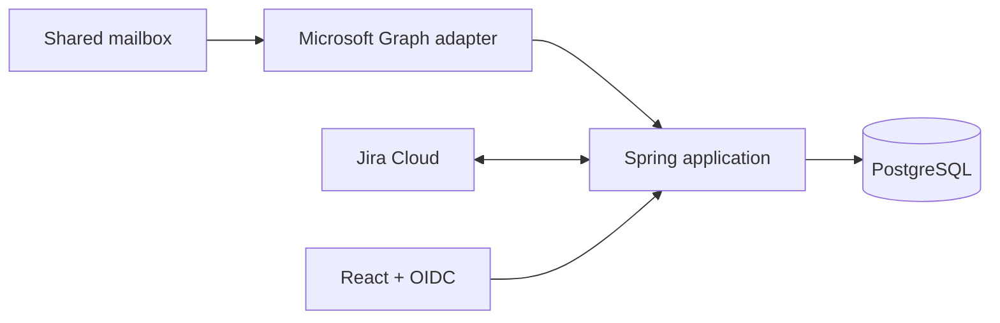

# EVIM — Vendor support inbox and SLA tracking

A proof of concept for centralizing vendor support: ingest shared-mailbox email,
rebuild portal threads, link conversations to Jira tickets, and track who owns
the next response.

**Status:** Discontinued proof of concept · Anonymized, outdated portfolio snapshot.
The internal product continued with a different architecture, including direct
Zendesk integration. Company names, real data and infrastructure were removed.

[Run and build](#run-and-build) · [Development guide](docs/development.md) ·
[Frontend reference](docs/frontend.md) · [Backend reference](docs/backend.md)

| Support inbox and email thread                                                      | Inbox with Jira details                                                  |
| ----------------------------------------------------------------------------------- | ------------------------------------------------------------------------ |
|  |  |

| SLA metrics                                                                   | Administration                                                            |
| ----------------------------------------------------------------------------- | ------------------------------------------------------------------------- |
|  |  |

_The interface is in Brazilian Portuguese. Screenshots use fictitious data and a mocked Jira integration._

## Overview

EVIM demonstrates a vendor-support workflow that combines email threads,
project tickets, and response-time ownership.

- Parse support-portal email into individual messages, authors and timestamps.
- Clean signatures and boilerplate and unwrap Safe Links and Proofpoint URLs.
- Connect conversations to Jira through OAuth or a service account.
- Track whether internal teams or vendors own the next response.
- Configure inbox, SLA metrics and administrative settings.

## Stack

| Layer        | Technologies                            |
| ------------ | --------------------------------------- |
| Frontend     | React 19, Vite 8, OIDC, TanStack Query  |
| Backend      | Java 21, Spring Boot 4, Spring Security |
| Integrations | Microsoft Graph, Jira Cloud, Keycloak   |
| Database     | PostgreSQL                              |
| Verification | Maven tests, npm build                  |

## Run and build

This snapshot does not run as a standalone demo: authenticated routes require
Keycloak, and inbox data requires a Jira Cloud site. Its build and tests do not
need these integrations.

```bash
cd backend
./mvnw test
```

```bash
cd frontend
npm ci
npm run build
```

To configure a local instance, start PostgreSQL from `backend/`, set the backend
environment variables, configure the Keycloak client in `frontend/.env`, and
start the Vite server. The [development guide](docs/development.md) explains the
local requirements and what remains unavailable in this archived snapshot.

## Architecture



The backend uses ports and adapters to isolate Jira and Graph integrations from
the application workflows. Email parsing splits support-portal thread history
into structured messages; SLA services track ownership changes. The React
frontend provides an authenticated paginated inbox, Jira detail panel and
configuration views.

See the [backend reference](docs/backend.md) for integration flows, data model,
security and API endpoints.

## Documentation

| Guide                                  | Contents                                            |
| -------------------------------------- | --------------------------------------------------- |
| [Development](docs/development.md)     | Build commands, local services and snapshot limits  |
| [Frontend reference](docs/frontend.md) | Routes, components, configuration and consumed APIs |
| [Backend reference](docs/backend.md)   | Architecture, integration flows, database and API   |

## Project context

The repository is an anonymized portfolio reference for a client B2B workflow.
All displayed records are fictitious. The live product and its infrastructure
are not included in this snapshot.

All rights reserved.
